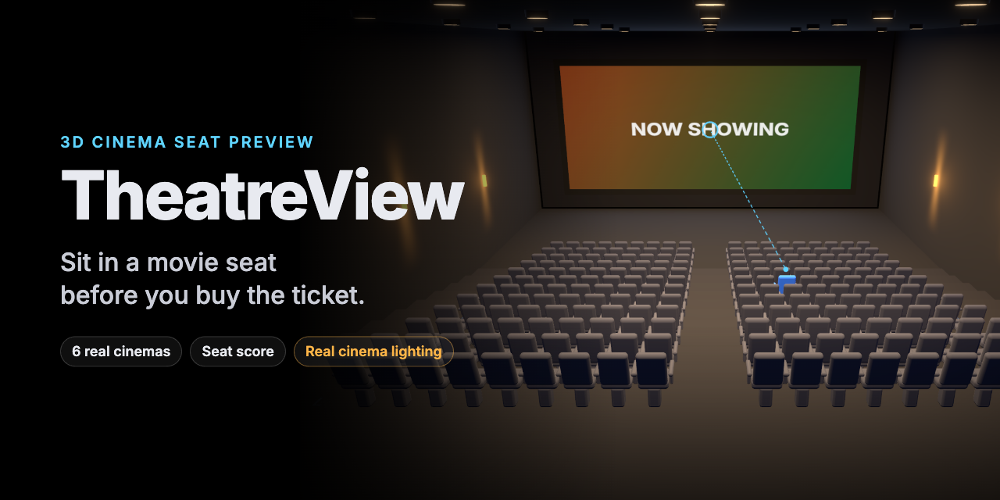
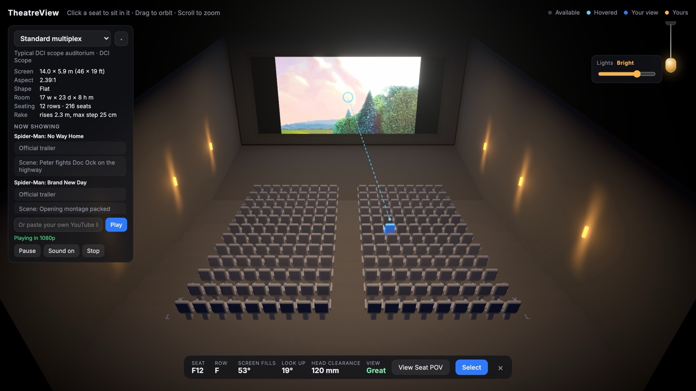
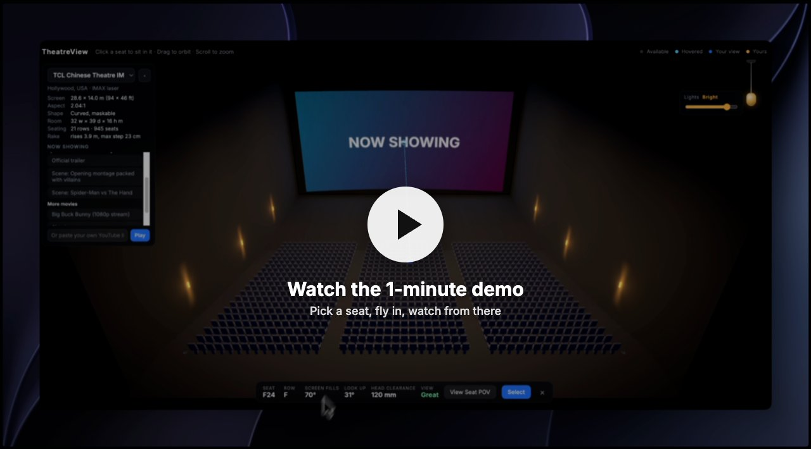
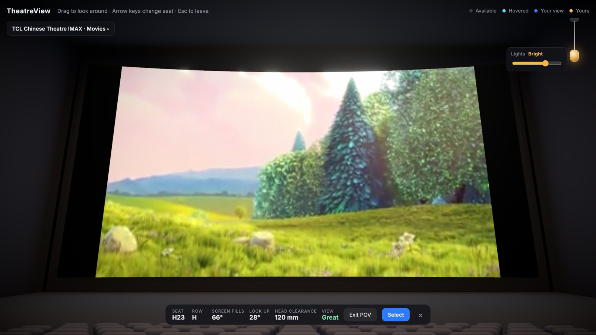

# TheatreView

**Sit in a movie seat before you buy the ticket.**

**[▶ Try it live](https://theatre-view.vercel.app)** · **[Watch the demo](docs/demo.mp4)** · [How it works](#how-it-works) · [My Thinking](#my-thinking)

Pick a seat in a 3D movie theater. The camera flies into that seat. You see the screen just like
you would from there. Then you know if it is a good seat.



## Demo

[](docs/demo.mp4)

A one-minute screen recording: picking a theater and a movie, sitting in a few seats, hopping
between them, and flying back out. (The recording has no sound. The movie clips in it are Spider-Man
trailers played from YouTube; they belong to Sony Pictures and Marvel.)

Or open it yourself: **[theatre-view.vercel.app](https://theatre-view.vercel.app)**

## Why I made this

I just saw this idea on LinkedIn. I got inspired, so I started building it.

When you book a movie, you pick a dot on a flat map. You never really know what the view will be
like until you get there. Is the screen too big? Do you have to look up? Will the person in front
block you? TheatreView lets you find out first.

## What it can do

- **Click a seat to sit in it.** The camera flies to that seat at eye height and looks at the screen.
- **Look around.** Drag to turn your head. Use the arrow keys to move to the next seat.
- **See a score for every seat.** It tells you how much of your view the screen fills, how far
  you look up, how much room there is over the head in front of you, and if the seat is Great,
  Good, Far, Very close or Neck strain.
- **Try real theaters.** Switch between six theaters, from a normal one to the biggest IMAX
  screen in the world. Each one uses the real screen size.
- **Pull the light cord.** A string hangs at the top right. Pull it down to make the room
  brighter. Pull again to change it. There is also a slider.
- **Curved and flat screens.** Some theaters have a curved screen, so the app bends it too.
- **Lit like a real cinema.** Round lights in the ceiling with a faint glow under each one, warm lamps
  on the walls, and small amber lights on every aisle step. They all dim together.
- **Fits your screen.** The starting view moves as close as it can so the whole theater fills your
  window, on a laptop or a phone.
- **Pick a movie.** Under "Now showing" you can pick from a list: Spider-Man: No Way Home and
  Spider-Man: Brand New Day (trailers and scenes), plus free Blender movies. The Blender movies play
  in sharp 1080p straight on the 3D screen, with no YouTube buttons. Or paste your own
  YouTube link, or a direct `.mp4` or `.webm` link.



## Try it

The easiest way is the live site: **[theatre-view.vercel.app](https://theatre-view.vercel.app)**.
It works in Chrome, Edge, Brave, Firefox and Safari on a laptop or desktop.

To run it on your own computer, you need [Node.js](https://nodejs.org) 20.19 or newer.

```bash
git clone https://github.com/rmagdaleena2508-01/TheatreView-.git
cd TheatreView-
npm install
npm run dev
```

Then open the link it prints (it looks like `http://localhost:5173`).

Other commands:

| Command | What it does |
|---|---|
| `npm run dev` | Starts the app on your computer |
| `npm run build` | Checks the code and makes a version ready to put online |
| `npm run preview` | Opens the online-ready version so you can check it |
| `npm run lint` | Looks for small mistakes in the code |

### Turn on booking (optional)

The app works without this. You only need it for holding and booking seats.

Booking is built but switched off on the live site for now. To turn it on:

1. Make a free project at [supabase.com](https://supabase.com).
2. In the project, open **Authentication → Sign In / Providers** and turn on **Allow anonymous sign-ins**.
3. Open the **SQL Editor** and run these files, in this order:
   - `supabase/migrations/20261014000000_phase4_booking.sql`
   - `supabase/migrations/20261014010000_show_movies.sql`
   - `supabase/seed.sql`
4. Copy `.env.example` to `.env.local` and fill in your project URL and publishable key
   (from **Project Settings → API Keys**).
5. In `src/config.ts`, change `BOOKING_ENABLED` to `true`.
6. Run `npm run dev` again.
7. For the live site, add the same two keys in **Vercel → Project → Settings → Environment Variables**
   and deploy again.

## How to use it

| Do this | What happens |
|---|---|
| Pick a theater in the box at the top left | The room changes to that theater |
| ◂ / ▸ on the left panel | Folds the panel away or opens it again |
| Move your mouse over a seat | A line shows where that seat looks at the screen |
| Click a seat | You sit in it |
| Drag (while sitting) | You look around |
| Arrow keys (while sitting) | You move to the seat next to you, in front, or behind |
| Esc | You stand up and fly back out |
| Drag (not sitting) | You walk around the room |
| Scroll (not sitting) | You zoom in and out |
| Pull the cord, or press L | The lights change: Movie, Dim, Bright, Full |
| Pick a movie under "Now showing" | That movie plays on the big screen |
| Paste a YouTube link and press Play | Your own video plays on the big screen |
| Pause / Sound on / Stop | Controls the movie (it starts muted) |
| Select | Marks the seat as yours (with booking on, it holds the seat for 5 minutes) |
| Pick a showtime *(booking on only)* | The seat map shows which seats are taken for that show |
| Book seat *(booking on only)* | Books the seat you are holding |

## How it works

Think of the app like a restaurant.

| Restaurant | TheatreView | What it is |
|---|---|---|
| The room you eat in | **Frontend** | The 3D theater you see in your browser |
| The waiter | **API** | Carries messages, like "Is seat E6 free?" |
| The kitchen | **Backend** | Keeps the real list of seats and bookings |
| The fridge | **Database** | Stores everything so nothing gets lost |
| Delivery trucks | **Outside services** | Movie posters, payments, AI help |

The frontend is done and live. The backend is built and tested, but switched off on the live site until
booking launches.

```
You (browser)
    |
    v
Frontend: the 3D theater  (React + three.js)
    |   "Is E6 free?"  "Book E6 for me"
    v
API + Backend + Database  (Supabase, built, switched off for now)
    |
    v
Outside services  (movie posters, payments, AI, coming in Phase 5)
```

## Tech stack

| Part | Tool | Why I picked it |
|---|---|---|
| Building the app | [Vite](https://vite.dev) + [React](https://react.dev) + [TypeScript](https://www.typescriptlang.org) | Fast to start, and TypeScript catches mistakes early |
| 3D | [three.js](https://threejs.org) + [React Three Fiber](https://r3f.docs.pmnd.rs) | The most used way to make 3D on the web, written the React way |
| 3D helpers | [drei](https://github.com/pmndrs/drei) | Ready-made pieces, like the dashed line from seat to screen |
| Camera moves | [camera-controls](https://github.com/yomotsu/camera-controls) | Dragging and turning your head, plus my own curved flights in and out of seats |
| YouTube on the 3D screen | three.js `CSS3DRenderer` | Places the real YouTube player on the screen, and only moves it when the camera moves |
| Movie streams | [hls.js](https://github.com/video-dev/hls.js) | Plays HLS streams in sharp quality as a real 3D picture; loads only when you pick a stream |
| Glow | [@react-three/postprocessing](https://github.com/pmndrs/react-postprocessing) | Makes the screen and lamps glow, and darkens the edges |
| Smooth fades | [maath](https://github.com/pmndrs/maath) | Fades the lights in and out like a real theater |
| Shared memory | [zustand](https://github.com/pmndrs/zustand) | One small place that remembers the seat, the theater and the lights |
| Font | [Inter](https://rsms.me/inter/) via [Fontsource](https://fontsource.org) | One font everywhere, shipped with the app instead of from a font website |
| Backend | [Supabase](https://supabase.com) (Postgres, Realtime, Auth) | Database, safe booking steps, live seat updates and guest sign-in in one place |
| Hosting | [Vercel](https://vercel.com) | Live now; puts the app online every time I push code |

## The phases

I am building TheatreView in **6 phases**. Click a phase to see the details.

<details>
<summary><b>Phase 1: The room</b> ✅ Done</summary>

<br>

- A 3D theater with a big screen, a sloped floor, walls and lamps.
- 216 seats. All of them are drawn as one object, so the app stays fast.
- Move your mouse over a seat and it lights up.
- A dashed line goes from the seat to the screen, with a ring where it lands.
- The camera flies into a seat, and you can turn your head.
- A bar at the bottom shows the seat, the row and the buttons.
- A pull cord for the lights, with real spring movement.

</details>

<details>
<summary><b>Phase 2: Real theaters</b> ✅ Done</summary>

<br>

- Six theaters with their real screen sizes:
  - Standard multiplex
  - Dolby Cinema
  - BFI IMAX, London
  - TCL Chinese Theatre IMAX, Hollywood
  - IMAX Melbourne
  - Traumpalast IMAX, Leonberg (the biggest IMAX screen in the world)
- Each room is built with real theater design rules: how far the first and last rows can be, and
  how high each row must be so you can see over the person in front of you.
- Curved screens are bent into a real curve.
- Every seat gets a score.
- All facts and links are in [docs/CINEMA_RESEARCH.md](docs/CINEMA_RESEARCH.md).

</details>

<details>
<summary><b>Phase 3: Make it feel real</b> 🚧 Mostly done</summary>

<br>

- ✅ Play a real movie on the screen: a movie list (Spider-Man trailers and scenes, free Blender
  films), your own YouTube link, or a stream link.
- ✅ Sharp 1080p streams painted straight onto the 3D screen, with no YouTube buttons.
- ✅ Better chair model: padded seat, leaning backrest, armrests, rounded edges.
- ✅ Lit like a real cinema: ceiling downlights, wall sconces, aisle step lights.
- ✅ The starting view fits your screen, and a loading screen shows until the room is ready.
- ✅ Smooth, curved camera flights in and out of seats.
- The screen's light changes color with the movie.
- Sound that comes from the screen, so it is quieter in the back rows.
- Touch controls for phones, a full-screen button, and a calm mode for people who do not like motion.

</details>

<details>
<summary><b>Phase 4: Backend and API</b> ✅ Built, switched off for now</summary>

<br>

**The short brief:** Phase 4 turns TheatreView from "look at a seat" into "really get a seat".
Many people can open the same show at the same time. When one person picks a seat, everyone else
sees it change right away, and nobody can ever get the same seat twice.

What is built:

1. **A database** (Supabase) with four lists: theaters, showtimes, seat holds and bookings.
2. **A showtime picker.** Each theater has a few showtimes. You pick one before you pick a seat,
   and that show's movie starts playing on the screen.
3. **Hold a seat for 5 minutes.** Press Select and the seat is yours for 5 minutes. A timer counts
   down. If time runs out, the seat is free again.
4. **Book it.** Press "Book seat" while your hold is still good, and the seat is booked for real.
   (Payment comes in Phase 5.)
5. **Live seat map.** Booked seats turn dark. Seats someone else is holding turn brown. It all
   changes on your screen without a refresh.
6. **No sign-up needed.** You get a quiet guest account the first time you hold a seat.
7. **Safe by design.** The browser can only ask the database to do things. The database checks
   every request, so a seat can never be booked twice, even if two people click at the same time.
8. **Ready for many people.** Browsers spread out their database requests and try again if it is busy.
9. **Still works without a backend.** Without booking, you can still preview every seat.

Status: the database is live and the safe hold and book steps were tested with two pretend people at
once. Booking is switched off on the live site (`BOOKING_ENABLED` in `src/config.ts`) until guest
sign-in is turned on in Supabase and the keys are added to Vercel.

</details>

<details>
<summary><b>Phase 5: Outside services</b> ⏳ Planned</summary>

<br>

- Movie posters and titles from [TMDB](https://www.themoviedb.org).
- Pretend payments with [Stripe](https://stripe.com) test mode, so no real money moves.
- An AI seat helper. You type "two seats on the aisle, not too close, I have a kid with me" and
  it picks seats and flies you there. The AI key stays on the server, never in the browser.

</details>

<details>
<summary><b>Phase 6: Put it online</b> 🚧 Mostly done</summary>

<br>

- ✅ Live on Vercel: [theatre-view.vercel.app](https://theatre-view.vercel.app).
- ✅ Faster loading: Lighthouse phone score went from 39 to between 52 and 78.
- ✅ Built files are cached for a year; a daily job keeps the database awake.
- ✅ Tested with 100 people at once.
- Split the big 3D code into smaller pieces.
- Count which seats people look at and which seats they buy.
- ✅ Make a demo video (in the Demo section above).

</details>

## My Thinking

These are the small choices I made along the way, and why. Click one to read it.

<details>
<summary><b>Click a seat and you sit in it right away</b></summary>

<br>

At first, clicking a seat only picked it. You had to press a second button to sit. That felt
wrong. Sitting in the seat is the whole point of the app, so now one click does it.

</details>

<details>
<summary><b>All the seats are one 3D object</b></summary>

<br>

The biggest theater has 945 seats. If every seat were its own object, the computer would have to
draw 945 things every frame. Instead, the app draws one seat shape 945 times in one go (this is
called instancing). It stays fast, and the app still knows which seat you clicked.

</details>

<details>
<summary><b>Turning your head, not walking around</b></summary>

<br>

When you sit, the camera spins around a point just in front of your eyes, not around the screen.
So when you drag, it feels like turning your head. You can turn about 43 degrees left or right
and about 23 degrees up or down, like a real person in a chair.

</details>

<details>
<summary><b>How the camera flies into a seat</b></summary>

<br>

The camera follows a smooth curve: it comes down onto the seat from above, looking at the screen
the whole way. When it lands, it quietly switches to "head turning" mode, so dragging turns your head
instead of swinging around the room. Leaving a seat is the same curve in reverse: up out of the row
first, then back.

Once you are sitting, moving to the next seat with the arrow keys is different: the camera just
slides straight across, still looking at the screen. That takes about a third of a second, so
hopping from seat to seat feels quick, like leaning over to the next chair.

</details>

<details>
<summary><b>Real screen sizes, but rule-based rooms</b></summary>

<br>

Theaters tell you their screen size. They do not tell you how deep the room is, how high the
ceiling is or how tall each step is. So the app uses the real screen size, then builds the room
with real design rules:

- The last row must still see the screen fill at least 36 degrees of your view (THX rule).
- No seat should see less than 30 degrees (SMPTE rule).
- The front row should not have to look up more than 35 degrees (more for IMAX, which wants to fill your view).
- Each row is raised just enough to see over the head in front by 12 to 15 cm.
- No step can be taller than 54 cm, because then you would need a railing.

Anything I had to guess is marked "approximated" or "assumed" in the research notes.

</details>

<details>
<summary><b>The floor steps get taller toward the back</b></summary>

<br>

I did not use the same step height for every row. Each row is lifted just enough so your eyes see
over the person in front of you to the bottom of the screen. The further back you go, the more lift
you need. That makes the real "stadium" shape you see in theaters.

</details>

<details>
<summary><b>A pull cord for the lights</b></summary>

<br>

The room was too dark to see the seats, so I needed a light switch. A plain button felt boring, so I
made a pull cord, like an old lamp. It stretches when you pull, swings, and springs back. Each pull
moves to the next light level. A slider is there too, for people who want exact control or use a
keyboard.

</details>

<details>
<summary><b>Lights fade, they do not snap</b></summary>

<br>

Real theaters fade the lights slowly. So the app fades them over about half a second. When the lights
go up, the fog in the room also moves back, so you can see the back rows.

</details>

<details>
<summary><b>The room starts bright</b></summary>

<br>

A dark theater looks cool, but you could not see the seats. So the app starts on "Bright". You can
pull the cord down to "Movie" when you want the real dark feeling.

</details>

<details>
<summary><b>Seat scores use real numbers</b></summary>

<br>

The score is not a guess. The app measures how wide the screen looks from your eyes, how far you look
up, and how much room there is over the head in front of you. Then it checks those numbers against
the THX and SMPTE rules.

</details>

<details>
<summary><b>How a YouTube video gets onto a 3D screen</b></summary>

<br>

YouTube does not let other websites read the pixels of its videos. That means the 3D engine cannot
paint a YouTube video onto the screen like a picture. So I did a trick: I put the real YouTube player
on the page and tilted and stretched it with CSS so it sits exactly on the 3D screen. When the camera
moves, the player moves with it.

The seats never cover the player, because the rows are built so every seat can see over the heads in
front to the bottom of the screen. So drawing the player on top always looks right.

A few small things came with this:

- The video starts **muted**, because browsers only let videos play by themselves when they are quiet.
  Press "Sound on" to hear it.
- You cannot click on the YouTube player itself, so that dragging still moves the camera. The Pause,
  Sound on and Stop buttons talk to the player for you.
- The video stays flat even on curved screens. The curves are small, so it is hard to notice.
- The movie list lives in `src/movies.ts`. I checked every title with YouTube's own lookup service, so
  the names match the real videos.
- Some videos do not allow playing on other websites. Those will show an error inside the player.

Direct `.mp4` or `.webm` links work a different way. They become a real 3D picture, so they glow and
bend with curved screens. The website that hosts the file has to allow it (this is called CORS).

</details>

<details>
<summary><b>The light cord follows your hand</b></summary>

<br>

At first, the cord swung the wrong way. If you pulled left, it went right. That is because the
screen turns things clockwise for a positive angle, and I forgot to flip it. Now the knob stays
exactly under your mouse while you hold it, and the cord points from where it hangs to your hand.
When you let go, it keeps its swing and springs back, like a real string.

</details>

<details>
<summary><b>The database does not store where seats are</b></summary>

<br>

The app already builds every theater the same way every time from the theater's numbers. So seat
"H12" in the multiplex is always in the same spot. The database only needs to know "show 5, seat H12
is booked". This keeps the database small and means I never have two copies of the seat map that
could disagree.

</details>

<details>
<summary><b>Holds run out by themselves</b></summary>

<br>

Each hold has an "until" time. The database only counts a hold if that time has not passed yet. So
nothing has to wake up and delete old holds on time. A seat is free the very second its hold runs out.

</details>

<details>
<summary><b>Two people can never get the same seat</b></summary>

<br>

The browser is not allowed to change the seat lists directly. It can only ask the database to "hold
this seat" or "book this seat". The database does the check and the change in one single step, so
there is no gap where two people can sneak in. On top of that, the bookings list has a rule that one
seat in one show can only be booked once.

</details>

<details>
<summary><b>Guest accounts instead of sign-up</b></summary>

<br>

Asking for an email before you can even try a seat felt like too much. So the app makes a quiet guest
account the first time you hold a seat. That way every hold still belongs to someone. Email sign-in
can come later, when you actually pay.

</details>

<details>
<summary><b>Live updates say "something changed", not "who did it"</b></summary>

<br>

When a hold or booking changes, the database sends a tiny message: "seat H12 changed". Every open
browser then asks for the latest seat map. The message never says who took the seat, so nobody's
info leaks. The app also asks for the seat map right after it connects, in case a change slipped by
while it was connecting.

</details>

<details>
<summary><b>A movie list, and every showtime has its movie</b></summary>

<br>

Pasting a link is nice, but most people just want to press a button. So "Now showing" has a short
list, grouped by movie: Spider-Man: No Way Home, Spider-Man: Brand New Day, and a few free Blender
movies. The paste box is still there for anything else.

Each showtime in the database also says which movie it plays. When you pick a showtime, that movie
starts on the screen, so the booking part and the screen always match.

The videos stay on YouTube and play in YouTube's own player. The app does not copy or store them.
Some of the scene clips are uploaded by fan channels, so they could be taken down one day. If that
happens, YouTube shows its own message on the screen and you can pick another one.

</details>

<details>
<summary><b>The camera fits the room to your screen</b></summary>

<br>

At first the starting camera was always in the same spot. On a wide laptop screen that made the
theater look tiny, with lots of black space around it. Now the app measures your window and moves
the camera as close as it can while the whole screen and every seat still fit. Wide screens get a
lower, "standing at the back" view. Tall phone screens get a higher view from above. It does this
again when you resize the window.

The camera always stays exactly in the middle of the room, looking straight at the screen, so the
theater never looks turned or tilted. (An earlier version slid the camera sideways to make room for
the panel, and that made the whole room look a little turned to the right.)

The info panel on the left can now be folded away with the ◂ button. On small laptop screens it
starts folded, so it does not cover the seats. When it is open, the room is framed a little
smaller so the panel does not cover it.

</details>

<details>
<summary><b>Making it fast, and keeping the movie smooth</b></summary>

<br>

I measured first with Lighthouse on a phone setting. The first score was 39 out of 100. The page was
busy for over 17 seconds, mostly because the 3D room was being drawn again and again, 60 times a
second, even when nothing moved.

What I changed:

- **Draw only when something changes.** The room now draws a new picture only when the camera moves,
  a seat lights up, or the lights fade. While you watch the movie, the 3D part rests, so the video gets
  the computer's full attention. This was the biggest fix for the movie getting stuck.
- **Show something right away.** The page shows "Building the theater…" the moment it opens, before
  the big 3D code arrives.
- **Load things later.** The YouTube player waits until the room is ready. The booking code loads only
  when it is needed.
- **No extra downloads from other sites.** The row letters used to download a font from another
  website. Now they are drawn with the app's own font (Inter, shipped with the app).
- **Remember files.** Built files have a fingerprint in their name, so browsers can keep them for a
  year and not download them again.
- **YouTube quality.** YouTube picks the picture quality from how big its player is and how fast the
  internet is. Websites cannot force a quality anymore. I tried a bigger player, but it made camera
  moves feel heavy, so it is back to 1280×720, which still allows HD on sharp laptop screens.

After these changes the score went up to between 52 and 78 (it changes from run to run), and the busy
time dropped from about 17 seconds to between 0.2 and 4 seconds.

The site has no server code, so there is nothing to "wake up". It is served from Vercel's network,
close to each visitor. The database is in Mumbai. Free databases fall asleep after a week with no
visitors, so a small daily job keeps it awake.

</details>

<details>
<summary><b>One font everywhere</b></summary>

<br>

Before, the app asked for the Inter font but never loaded it, so every computer showed its own
font, and the buttons and boxes used yet another one. Now Inter comes with the app itself (not from
a font website), and every part uses it: the panels, the buttons, the loading screen, and even the
row letters and words painted inside the 3D theater.

</details>

<details>
<summary><b>The link preview picture</b></summary>

<br>

When someone shares the link on LinkedIn or WhatsApp, a picture shows up. I made that picture from a
real render of the 3D theater, with the name and a short line next to it. It uses only our own
picture, not frames from the movies, because those belong to the movie studios.

</details>

<details>
<summary><b>Two ways to play a movie, and why</b></summary>

<br>

I looked at how other people put video inside a 3D world. There are two ways:

1. **Put YouTube's own player on top of the 3D screen** (what the three.js "CSS3D YouTube" example
   does). This is the only allowed way to show YouTube videos like the Spider-Man trailers. But
   YouTube decides the picture quality by itself, it shows its own buttons, and YouTube's rules say
   websites must not hide them. Websites cannot force 1080p anymore; YouTube removed that in 2019.
2. **Play the video file ourselves and paint it onto the 3D screen** (a "video texture"). This gives
   full control: the app can start at the best quality, there are no YouTube buttons, the picture
   bends with curved screens, and it glows like a real projector. But you need the right to show the
   video, and the place it comes from has to allow it.

So I use both. The Spider-Man clips stay on YouTube. The free Blender movies play the second way, as
HLS streams (a video cut into small pieces in several qualities, the way Netflix-style players work).
The app starts at the best quality and only drops down if the internet gets slow. The panel shows the
quality it is playing, like "Playing in 1080p".

Some details:

- The film keeps its own shape. A 16:9 movie on a wide 2.39:1 screen gets black bars on the sides,
  like a real projector, instead of being stretched.
- The 3D room draws a new picture only when the video has a new frame (about 24 times a second), not
  as fast as it can.
- The stream player code (hls.js) loads only when you pick a stream, so it does not slow down the
  first visit.
- Right now the streams come from free public test servers (Mux and Unified Streaming). For a real
  launch, the movies should move to a paid video host like Cloudflare Stream, Mux or Bunny Stream.

</details>

<details>
<summary><b>Lights that look like a real cinema</b></summary>

<br>

The first ceiling lights were long, flat glowing bars. They looked fake. Real cinemas light the room
in layers, all warm white (about 2700 to 3000 K), and all dim together before the film:

- **Recessed downlights.** Round cans set into the ceiling, in a grid over the seats. Each one has a
  dark metal ring, a glowing lens, and a very faint cone of light below it. Cinemas keep the air clear,
  so the cones are barely there, brightest right under the lens. The cones are a cheap trick (a soft
  see-through shape added on top), not real fog, so they cost almost nothing to draw.
- **Wall sconces.** Small glowing cylinders on the side walls that paint a warm "scallop" of light up
  and down the wall, like the fixtures you see in most theaters.
- **Aisle step lights.** Tiny amber lights on every step of every aisle, so people can find their
  way in the dark. They stay on, dimly, even when the film is playing.
- **A ceiling.** You only see it from inside the room. From the starting view above the room it is
  see-through, so the fixtures are hidden there too and nothing floats in the air.

The seats are still lit by a few soft area lights in the ceiling. Using one real spotlight per
downlight would be far too slow, so the downlights are for looks and the area lights do the work.

I had one funny bug: the cones made the whole picture go black. A tiny math mistake in the cone
shader made "not a number" values, and the glow effect spread them over the whole screen. Clamping
the numbers fixed it.

</details>

<details>
<summary><b>A loading screen you can actually see</b></summary>

<br>

The page used to show "Building the theater…" for only a moment. As soon as the app's code
started, the message disappeared, and then the screen stayed black for a second or two while the
browser prepared all the 3D lighting and glow effects. That felt slow and broken.

Now the loading screen stays until the 3D room has really drawn its first picture, and then it fades
away. While it shows, the browser prepares the 3D effects in the background, so the first picture
comes faster.

</details>

<details>
<summary><b>Smoother hovering over seats</b></summary>

<br>

Each time the mouse moves onto a new seat, the 3D room draws a new picture. The old way of placing
the YouTube player on the screen moved the player again on every one of those pictures, even when
nothing about the camera had changed. On some laptops that made hovering feel slow. Now the player
uses three.js's own CSS3D renderer, which only moves the player when the camera really moves.

</details>

<details>
<summary><b>Showtimes are switched off for now</b></summary>

<br>

The showtime picker and booking are built (Phase 4), but the live site does not have booking turned
on yet. Showing a picker that does nothing would be confusing, so it is hidden until booking launches.
It is one switch in the code (`BOOKING_ENABLED` in `src/config.ts`).

</details>

<details>
<summary><b>Clicking a seat with no lag</b></summary>

<br>

I measured what happened between your click and the camera moving. Three things were slowing it:

1. **The camera jumped instead of flying.** The 3D room only draws when something changes. After it
   sat still for a while, the first new frame said "3 seconds have passed", so the camera did the
   whole trip in one step. I now use my own small wrapper around the camera tool that never lets one
   frame count for more than 1/30 of a second.
2. **A pause in the middle of the flight.** The ceiling lights were hidden while the camera was above
   the room and switched on when it flew inside. Switching them on made the browser stop for about
   0.1 seconds to get them ready. Now they are always there: the lenses face down, so you can't see
   them from above anyway, and the light cones just fade out.
3. **A slow, floaty ease.** The flight now settles faster.

Now the click is noticed in under 20 milliseconds, the camera starts moving right away, and it reaches
the seat in about 0.7 seconds with no stalls.

</details>

<details>
<summary><b>Working for 50 or 100 people at the same time</b></summary>

<br>

**The website itself.** The app is just files (no server code), and Vercel copies those files to
computers all over the world, close to each visitor. A visitor's 3D room runs on their own computer, so
100 people do not slow each other down. In a test, the page answered 10,000 requests in 15 seconds
with no errors.

**The database (when booking is switched on).** Supabase's free plan allows 200 live connections and
100 live messages per second. In a test, 100 people asking for the seat map at the same moment all got
an answer. To keep it calm when many people are booking:

- Booking is switched off for now (`BOOKING_ENABLED` in `src/config.ts`). While it is off, the app
  never talks to the database, so there is nothing to overload.
- When someone takes a seat, every browser hears about it. Instead of all asking the database at the
  same instant, each one waits a short random moment, and several changes close together become one
  request.
- If the database is busy for a moment, the app tries again a little later instead of giving up.
- Two people can never get the same seat, because the database checks and saves a hold in one step.

**What would need an upgrade for a real launch:**

- More than about 150 people at once with booking on: Supabase Pro (500 connections, 500 messages a
  second).
- The free Blender movie streams come from public test servers. Many people watching at once should use
  a real video host like Cloudflare Stream, Mux or Bunny Stream.

</details>

<details>
<summary><b>Smooth flights in and out of seats, and real-looking chairs</b></summary>

<br>

When you left a seat, the camera flew backwards in a straight line at head height, right through the
rows behind you. Chairs flashed in and out as the camera passed through them, and the move looked
like it was cutting. Now the camera follows a smooth curve: it lifts up out of the row first, then
sweeps back. Going in, it comes down onto the seat from above. Both moves start the instant you click
and settle gently, and hopping to the next seat is a quick slide.

The chairs used to be plain boxes. Now each chair is built like a real cinema seat: a padded cushion,
a padded backrest that leans back about 12 degrees, armrests on posts, and a base, all with rounded
edges so the light rolls over them. Blender was not available on my computer, so the chair is built
in code from rounded shapes, which also keeps it small.

A detailed chair has about 1,000 triangles, and the biggest theater has 945 chairs. Checking the mouse
against all of those triangles every time it moves would be slow, so the mouse is checked against one
invisible simple box per chair instead. The chairs you see and the boxes you point at line up exactly.

</details>

<details>
<summary><b>Some things are left out on purpose</b></summary>

<br>

- **AMC Lincoln Square IMAX** is not in the app. Different websites give different screen sizes, so I
  did not trust them.
- **The shortcut keys** (L, arrows) do nothing while you are typing in a box or picking a theater.

</details>

## Folder map

```
src/
  venues.ts           the real theaters and their screen sizes
  layout.ts           builds the room: rows, steps, seats, and the seat score
  store.ts            remembers the theater, the seat, the lights, and the movie
  movie.ts            reads YouTube and video links, and talks to the YouTube player
  movies.ts           the movie list under "Now showing" (YouTube links and HLS streams)
  App.tsx             puts the 3D room, the buttons and the loading screen on the page
  config.ts           switches for features that are built but not live yet
  fonts.ts            loads the Inter font for the whole app
  hls-light.d.ts      type notes for the small version of the stream player
  scene/
    Theater.tsx       the screen (flat or curved), the movie on it, floor, walls, row letters
    Seats.tsx         all the seats, mouse-over and click
    CameraRig.tsx     the camera flying in and out of seats
    framing.ts        finds the best starting camera for your window size
    Sightline.tsx     the dashed line from seat to screen
    Lighting.tsx      downlights, wall sconces, step lights, and how bright they are
  ui/
    Hud.tsx           the theater box, the seat bar, and shortcut keys
    LightCord.tsx     the pull cord and light slider
  backend/
    supabase.ts       connects to Supabase (only if keys are set)
    booking.ts        showtimes, holds, bookings, and live updates
supabase/
  migrations/         the database tables, safety rules, and functions
  seed.sql            demo theaters and showtimes
docs/
  CINEMA_RESEARCH.md  real theater facts, design rules, and links
  demo.mp4            the one-minute demo recording (no sound)
  images/             screenshots, the demo preview, and the link preview picture
public/
  og-image.png        the picture shown when someone shares the link
.github/workflows/
  keep-warm.yml       daily job that keeps the free database awake
vercel.json           tells Vercel to cache built files for a year
.env.example          the two Supabase keys to fill in for booking
PLAN.md               the full product plan
```

## Putting it online

The app is only files, so there is no server to run or wake up.

- **Hosting:** [Vercel](https://vercel.com) builds the app with `npm run build` every time code is pushed
  to `main`, and serves the files from computers close to each visitor.
- **Caching:** `vercel.json` tells browsers they may keep the built files for a year. Each file has a
  fingerprint in its name, so a new version always gets a new name.
- **Environment variables** (only needed for booking):

  | Name | What it is |
  |---|---|
  | `VITE_SUPABASE_URL` | Your Supabase project address |
  | `VITE_SUPABASE_PUBLISHABLE_KEY` | Your Supabase publishable key (safe to show in the browser) |

- **Database:** Supabase, in Mumbai. The free plan sleeps after a week with no visitors, so
  `.github/workflows/keep-warm.yml` pings it once a day. (GitHub stops scheduled jobs after 60 days with
  no activity in the repo.)

## Known problems

- The 3D code is still one big file (about 470 KB zipped). The booking and stream player code are
  already split out.
- YouTube shows its own little buttons and title at the start of a video. The rules for using
  YouTube's player say websites must not cover them up.
- YouTube picks the picture quality by itself. Websites cannot force 1080p.
- The free Blender films stream from public test servers (Mux and Unified Streaming). They can be slow
  or go away. A real launch should use a paid video host.
- Booking is switched off on the live site for now.
- Supabase's free plan allows 200 live connections and 100 live messages a second. Busy ticket sales
  with booking on would need the Pro plan.

## Help make it better

Ideas and fixes are welcome.

1. Fork this repo.
2. Make a new branch: `git checkout -b my-idea`
3. Make your change and check it with `npm run build`.
4. Push it and open a pull request.

If you find a bug, please open an issue and tell me what you clicked and what you saw.

## Credits and licenses

- **Big Buck Bunny, Sintel and Tears of Steel** © Blender Foundation |
  [www.blender.org](https://www.blender.org), shared under
  [Creative Commons Attribution 3.0](https://creativecommons.org/licenses/by/3.0/). The streams are
  provided by [Mux](https://www.mux.com) and [Unified Streaming](https://www.unified-streaming.com) test servers.
- **Spider-Man: No Way Home** and **Spider-Man: Brand New Day** trailers and clips belong to Sony
  Pictures and Marvel. They are not copied or stored here; they play from YouTube in YouTube's own
  player, from the channels named in `src/movies.ts`.
- **Inter** font by Rasmus Andersson, under the
  [SIL Open Font License](https://github.com/rsms/inter/blob/master/LICENSE.txt).
- Cinema screen sizes and design rules come from the sources listed in
  [docs/CINEMA_RESEARCH.md](docs/CINEMA_RESEARCH.md).

## Thank you

- The LinkedIn post that gave me this idea.
- [Codrops: Cinema Seat Preview Experiment](https://tympanus.net/codrops/?p=25885), an early version of this idea.
- [StadiView](https://github.com/fengjun8/stadiview), a stadium version that showed me how to handle lots of seats.
- [pmndrs](https://github.com/pmndrs), the people who make React Three Fiber, drei, zustand and maath.
- The README layout was inspired by [Best-README-Template](https://github.com/othneildrew/Best-README-Template) and [awesome-readme](https://github.com/matiassingers/awesome-readme).

## License

[MIT](LICENSE) for the code. You can use it, change it and share it. Just keep the license file.
The movies and the font keep their own licenses (see Credits and licenses).
